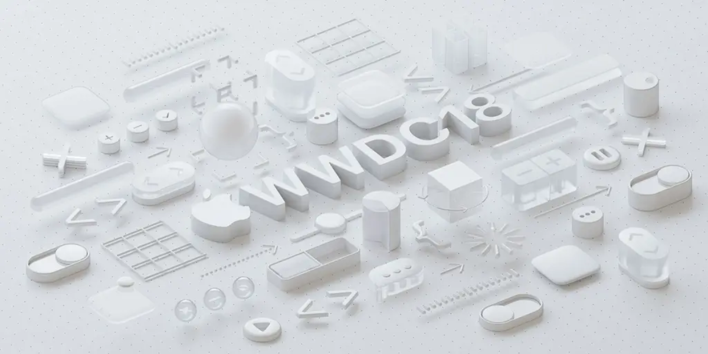

# WWDC 2018 - Scholarship

List of student submissions for the WWDC 2018 - Scholarship. The list is in alphabetical order.

### How to add your submission?
1. **[Click here to open the form](https://github.com/wwdc/2018/issues/new?template=submit.yml)** and fill it in.
2. Send it. A bot checks your entry within a minute and tells you if anything needs fixing. You can edit the form after sending.
3. When it is approved your entry appears on this list.

#### How to update or remove your submission?
Use the **[update form](https://github.com/wwdc/2018/issues/new?template=update.yml)**. Only the person who sent the entry can change it.

### Submissions

| Participant | Links  | Status            |
|:--|:--|:--|
| [Aaron Cheung](https://www.facebook.com/WahYanAaron) | [GitHub](https://github.com/AaronCheung430/WWDC2018) · [Video](https://youtu.be/t9Bp4rkPh7E) UIKit, AVFoundation, Gesture Recognizer |  |
| [Aaron Nguyen](https://github.com/attwelveDev) | [GitHub](https://github.com/attwelveDev/WWDC18-Submission) UIKit, AVFoundation |  |
| [Aashna Narula](https://github.com/aashna94) | [GitHub](https://github.com/aashna94/shapify) · [Video](https://youtu.be/INsfbSmFpyA) SpriteKit, UIKit |  |
| [Adann Simões](https://github.com/adannsergio) | [GitHub](https://github.com/adannsergio/WWDC18) PlaygroundBooks, UIKit, CoreGraphics |  |
| [Adrian Labbé](https://github.com/ColdGrub1384/) | [GitHub](https://github.com/ColdGrub1384/WWDC18) SpriteKit, UIKit |  |
| [Adrián Rubio](https://github.com/Adrxx) | [GitHub](https://github.com/Adrxx/Elastic-Cat-Toaster) · [Video](https://youtu.be/Gc8bZLghYFY) SpriteKit, GameplayKit |  |
| [Akshaya Dinesh](https://github.com/akshayadinesh/) | [GitHub](https://github.com/akshayadinesh/SpaceMathPlayground) SpriteKit, UIKit |  |
| [Albert Sanchez](https://github.com/AlbertSanIza/) | [GitHub](https://github.com/AlbertSanIza/TheHawkingCosmos) · [Video](https://youtu.be/7TKopNBXiHk) SpriteKit, SceneKit, AVFoundation, Foundation +1 |  |
| [Alessandro Izzo](https://github.com/Hantex9/) | [GitHub](https://github.com/Hantex9/PuzzlePipe) · [Video](https://youtu.be/SG972hlY8Ds) UIKit, GameplayKit, AVFoundation |  |
| [Alessandro Minopoli](https://github.com/alex010x) | [GitHub](https://github.com/alex010x/HackNscape) SpriteKit, PlaygroundBook |  |
| [Alex Santarelli](https://github.com/Alexs2424/) | [GitHub](https://github.com/Alexs2424/WWDC18Submission) · [Video](https://youtu.be/1nwITyqhbsk) ARKit, JSON Parsing |  |
| [Alexandre Vassinievski](https://github.com/alexvassini) | [GitHub](https://github.com/alexvassini/ArDrawing) UIKit, ARKit, SceneKit |  |
| [Alexis Aubry](https://github.com/alexaubry) | [GitHub](https://github.com/alexaubry/MLMOJI) · [Video](https://www.youtube.com/watch?v=Z7jdLrorctQ) CoreML, CoreImage, TensorFlow, Playground Book |  |
| [Ali Kheirkhah](https://github.com/alikheirkhah/WWDC2018-student-Ali/) | [GitHub](https://github.com/alikheirkhah/WWDC2018-student-Ali/) UIKit, SpriteKit, ARKit |  |
| [Amanda Southworth](https://github.com/thecodingone) | UIKit, CoreML, AVFoundation, Vision +1 |  |
| [Amit Kalra](https://github.com/AMITNKALRA) | [GitHub](https://github.com/AMITNKALRA/WWDC--18-Playground--Student-Scholarship-) · [Video](https://www.youtube.com/watch?v=_5lBBduQzLo) UIKit, AVFoundation, Gesture Recognizer |  |
| [Andreas Neusuess](https://github.com/Tantalum73/) | [GitHub](https://github.com/Tantalum73/WWDC18ScholarshipSubmission) AVFoundation, UIKit, CoreAnimation, CoreImage |  |
| [Andy Vainauskas](https://github.com/AndyJVain) | [GitHub](https://github.com/AndyJVain/crack-the-code) AVFoundation, UIKit |  |
| [Anirudh Natarajan](https://github.com/aniNatarajan12/) | [GitHub](https://github.com/aniNatarajan12/RushToWWDC) · [Video](https://www.youtube.com/watch?v=IN3XOPIYWsY) ARKit, SceneKit, SpriteKit, AVFoundation |  |
| [Antonio Zaitoun](https://github.com/Minitour/) | [GitHub](https://github.com/Minitour/Micro-Interface-Builder) · [Video](https://www.youtube.com/watch?v=G0yjMRrsG7c) UIKit, SceneKit, CoreGraphics, CoreAnimation |  |
| [Anıl Gürses](https://github.com/anlgrses) | [GitHub](https://github.com/anlgrses/wwdc2018submission) UIKit, AVFoundation |  |
| [Arno Appenzeller](https://github.com/arnoappenzeller) | [GitHub](https://github.com/arnoappenzeller/WWC18-Scholarship-Submission) UIKit, PlaygroundBook |  |
| [Arthur Schiller](http://arthurschiller.de) | [Video](https://www.youtube.com/watch?v=5CnECMTf42k&t) UIKit, ARKit, SceneKit, SpriteKit +2 |  |
| [Arved Viehweger](https://github.com/arvedviehweger) | [GitHub](https://github.com/arvedviehweger/WWDC2018/tree/master) · [Video](https://www.youtube.com/watch?v=A6qPTykNCCQ&lc=) UIKit, SceneKit, AVFoundation |  |
| [Aryan Kashyap](https://twitter.com/NSAryan12) | UIKit, SpriteKit, AVFoundation, PlaygroundSupport +1 |  |
| [Aryeh Greenberg](https://github.com/arr00) | [GitHub](https://github.com/arr00/WWDC-2018-Playground) · [Video](https://www.youtube.com/watch?v=UoPWOobgWnk) SpriteKit, AVFoundation, UIKit |  |
| [August Heegaard](https://github.com/agisboye/) | [GitHub](https://github.com/agisboye/PokeGAN) AppKit, CoreML, Foundation |  |
| [Aulene De](https://github.com/Aulene/) | [GitHub](https://github.com/Aulene/CaptureTheAlien) SpriteKit |  |
| [Austin Fuller](https://github.com/AustinFuller/) | [GitHub](https://github.com/AustinFuller/WWDC2018Playground) UIKit, AVFoundation, CoreGraphics |  |
| [Axel Boberg](https://boberg.io) | [GitHub](https://github.com/axelboberg/WWDC18) CoreML, AVFoundation, UIKit |  |
| [Bahadir Oncel](https://github.com/b-onc) | [GitHub](https://github.com/b-onc/GuessTheView) UIKit |  |
| [Bart Wesselink](https://github.com/bartwesselink) | [GitHub](https://github.com/bartwesselink/wwdc18-smart-cars) · [Video](https://youtu.be/DXJYjCuj7YI) AVFoundation, SpriteKit, PlaygroundBooks |  |
| [Batuhan Saka](https://www.twitter.com/strawb3rryx7) | SpriteKit, UIKit, AVFoundation |  |
| [Ben Emdon](https://github.com/BenEmdon) | [GitHub](https://github.com/BenEmdon/8-Bit-MusicMaker) UIKit, AVFoundation |  |
| [Bernardo Sarto de Lucena](https://github.com/bslucena) | [GitHub](https://github.com/bslucena/wwdc18) · [Video](https://youtu.be/oVV-3rXvtx4) UIKit, SpriteKit |  |
| [Bradley Mackey](https://github.com/bradleymackey) | [GitHub](https://github.com/bradleymackey/rsa-playground) · [Video](https://youtu.be/d36YmVfUD9s) SpriteKit, SceneKit, GameplayKit, UIKit |  |
| [Brandon Chester](https://github.com/nexusCFX) | [GitHub](https://github.com/nexusCFX/Mixer) UIKit, AVFoundation, CoreAnimation |  |
| [Brenda Lau](https://github.com/brendalaupg) | [Video](https://youtu.be/GBjFjhVzFdc) CoreML, Vision, AVKit |  |
| [Bruno Chagas](https://github.com/bruno3chagas) | [GitHub](https://github.com/bruno3chagas/ShapeRave) · [Video](https://youtu.be/fM53qPnnk5M) SpriteKit, UIKit |  |
| [Bruno Scheltzke](https://www.linkedin.com/in/brunoscheltzke/) | [GitHub](https://github.com/BrunoScheltzke/Rhythm-Learning-Playground) · [Video](https://www.youtube.com/watch?v=-_mpH9haHxE&feature=youtu.be) UIKit, AVFoundation |  |
| [Carlo Carpio](https://github.com/CarloCarpio93) | [GitHub](https://github.com/CarloCarpio93/ProjectTesla) · [Video](https://www.youtube.com/watch?v=bxd26oV6p48&t=16s) SpriteKit, UIKit, Playground books |  |
| [Carlo Palumbo](https://www.linkedin.com/in/carlo-palumbo-992358111/) | [GitHub](https://github.com/patana93/Go-To-Space-With-Electronic-WWDC18) · [Video](https://youtu.be/QkqDQUVv5VQ) SpriteKit, Playground books |  |
| [Chan Jing Hong](https://github.com/cjinghong/) | [GitHub](https://github.com/cjinghong/RiddlePhoneX) · [Video](https://www.youtube.com/watch?v=IDysiA4j1RU) UIKit |  |
| [Charles Schacher](https://github.com/quoimec/) | [GitHub](https://github.com/quoimec/Colour) UIKit |  |
| [Charles-Olivier Demers](https://github.com/charlot567/) | [GitHub](https://github.com/charlot567/WWDC-2018) UIKit, SpriteKit, Playground book |  |
| [Chip Beck](https://github.com/ch1pa/) | [GitHub](https://github.com/ch1pa/WWDC-2018-Scholarship-Application/) UIKit, MapKit, AVKit, CoreGraphics |  |
| [Christian Schnorr](https://github.com/jenox/) | [GitHub](https://github.com/jenox/WWDC-2018-Bezier-Curves-in-Typography/) CoreGraphics &amp; CoreText |  |
| [Cibele Paulino](https://github.com/CibelePaulinoAndrade) | [Video](https://www.youtube.com/watch?v=ciyNZGnbcRw) SpriteKit, UIKit, Playground books |  |
| [Collin DeWaters](https://github.com/ctdewaters) | [GitHub](https://github.com/ctdewaters/WWDC18-Scholarship-Submission) · [Video](https://www.youtube.com/watch?v=pjHS3-3j1xQ) AppKit, SceneKit, AVFoundation |  |
| [Dalton Prescott](https://github.com/dustarion/) | [GitHub](https://github.com/dustarion/wwdc18) UIKit, SceneKit, CoreML, AVFoundation |  |
| [Daniel Gruber](https://github.com/danielgruber) | [Source](https://repo.goma-cms.org/users/daniel.gruber/repos/wwdc-2018/browse) UIKit, PlaygroundBooks, CoreGraphics |  |
| [Daniel Inderwies](https://github.com/daniel4Duniel) | [GitHub](https://github.com/daniel4Duniel/WWDC2018) · [Video](https://www.youtube.com/watch?v=aJufQDs8PLA) UIKit, SpriteKit, AVFoundation |  |
| [David Nadoba](https://github.com/dnadoba) | [GitHub](https://github.com/dnadoba/games-and-math-playgroundbook) · [Video](https://youtu.be/95x6WlrhlG4) SpriteKit, UIKit |  |
| [Débora Moura](https://github.com/deboramour4/) | [GitHub](https://github.com/deboramour4/KeepCalm) · [Video](https://www.youtube.com/watch?v=Z-cjsfjlDfQ) UIKit, CoreGraphics |  |
| [Dowland Aiello](https://github.com/dowlandaiello/) | [GitHub](https://github.com/dowlandaiello/Pop) · [Video](https://youtu.be/MWhHSGbS3gM) AppKit, SpriteKit, Foundation |  |
| [Eduardo Yutaka Nakanishi](https://github.com/eduardoyutaka) | [GitHub](https://github.com/eduardoyutaka/magical-sketch) · [Video](https://www.youtube.com/watch?v=H1Jo0hcLpIE) UIKit, CoreMotion |  |
| [Egor Zhdan](https://github.com/egorzhdan) | [GitHub](https://github.com/egorzhdan/wwdc18) Cocoa, SpriteKit |  |
| [Eliott Hauteclair](https://github.com/Eliottiosdevs/) | AVFoundation, UIKit |  |
| [Emannuel Carvalho](https://github.com/emannuelOC/) | [GitHub](https://github.com/emannuelOC/WWDC2018) · [Video](https://www.youtube.com/watch?v=o0N6a5QapB0&feature=youtu.be) Vision, CALayer, CoreAnimation, AVCapture +1 |  |
| [Erick Borges](https://github.com/ericklborges) | [GitHub](https://github.com/ericklborges/Animandalas) · [Video](https://www.youtube.com/watch?v=ljRl9g29zg0&feature=youtu.be) CoreGraphics |  |
| [Erik Martin](https://github.com/techgeek1129) | [GitHub](https://github.com/techgeek1129/WWDC-2018-Scholarship-Submission) SpriteKit, Cocoa |  |
| [Erik Maximilian Martens](https://www.linkedin.com/in/erik-maximilian-martens-212280a1/) | [GitHub](https://github.com/erikmartens/WWDC-2018-Scholarship-Submission) UIKit, SpriteKit |  |
| [Ethan Humphrey](https://github.com/ethantheinnovator/) | [GitHub](https://github.com/EthanTheInnovator/SearchForMacOS) · [Video](https://youtu.be/cUQqg0XxhhM) SpriteKit |  |
| [Ferdinand Loesch](https://github.com/ferdinandl007) | [GitHub](https://github.com/ferdinandl007/WWDC-project-2018) AVFoundation, CIDetector, SpriteKit, Cocoa |  |
| [Florian Pfisterer](https://github.com/FlorianPfisterer) | [GitHub](https://github.com/FlorianPfisterer/wwdc18-playground) CoreGraphics, CoreAnimation, UIKit, CoreText |  |
| [Francesc Bruguera](https://github.com/ifrins) | [GitHub](https://github.com/ifrins/wwdc-2018-atc-playground/) · [Video](https://youtu.be/pWUEkQliDcc) UIKit, CoreGraphics, PlaygroundBooks |  |
| [Francesco Chiusolo](https://github.com/Donald90) | [GitHub](https://github.com/Donald90/ExploringSpace) SpriteKit |  |
| [Francesco Trusiano](https://twitter.com/checcot) | [GitHub](https://github.com/FrancescoTr/WWDC-2018-Scholarship-Submission/) · [Video](https://youtu.be/XqmbZuS13Lo) SpriteKit, UIKit, PlaygroundBooks |  |
| [Francisco Fabregat](https://github.com/frankfabregat) | SpriteKit, GameplayKit, AVFoundation, UIKit |  |
| [Gabriel D'Luca](https://github.com/gabrieldluca) | [GitHub](https://github.com/gabrieldluca/celestial) · [Video](https://www.youtube.com/watch?v=iRJNFNwN-RE) UIKit, SceneKit, AVFoundation |  |
| [Gautham Elango](https://github.com/gg2001) | [GitHub](https://github.com/gg2001/SwiftChain) · [Video](https://youtu.be/4i_TtI5YmCs) UIKit |  |
| [Gennaro Amura](https://github.com/slade9220) | [Video](https://www.youtube.com/watch?v=hahbjaHiTOo) UIKit, Playground Book |  |
| [Geomar Bastiani](https://github.com/geomarb) | [GitHub](https://github.com/geomarb/wwdc2018) · [Video](https://youtu.be/WpgWFSBuUa0) SpriteKit |  |
| [Geremia De Micco](https://github.com/geredm) | [GitHub](https://github.com/geredm/WWDC-2018-Accepted-PlaygroundBook-Electron-Configuration) SpriteKit, UIKit |  |
| [Giovani Pereira](https://github.com/giovaninppc) | [GitHub](https://github.com/giovaninppc/SwiftPlaygrounds/tree/master/Hueco%20Mundo) UIKit, SpriteKit |  |
| [Giovanni Bassolino](https://github.com/giangi0/) | [Video](https://youtu.be/qjQM4c7tfRs) SpriteKit, GameplayKit, UIKit, AVFoundation |  |
| [Giovanni Luigi Bruno](https://github.com/GiovanniLuigi) | [GitHub](https://github.com/GiovanniLuigi/DotsAndBoxesPlayground/tree/master) · [Video](https://www.youtube.com/watch?v=FIID-XjP4DQ&feature=youtu.be) SpriteKit, GameplayKit, AVFoundation |  |
| [Grant Emerson](https://github.com/GrantJEmerson) | [GitHub](https://github.com/GrantJEmerson/Fireworks) AVKit, SpriteKit, UIKit, GameplayKit |  |
| [Guillermo Cique](https://github.com/GuiyeC) | [GitHub](https://github.com/GuiyeC/WWDC-2018) · [Video](https://youtu.be/MtLMERAibp8) UIKit, Playground Books, SpriteKit |  |
| [Guozheng Zhang](https://github.com/Daniel612) | [GitHub](https://github.com/Daniel612/MusicBall) · [Video](https://youtu.be/pjckwZjeH7U) ARKit, SceneKit, PlaygroundBooks |  |
| [Gustavo Crivelli](https://github.com/gmCrivelli) | [GitHub](https://github.com/gmCrivelli/Day-in-the-Park-WWDC18) UIKit, SpriteKit |  |
| [Haodong Hong](https://www.scauos.xin/) | [GitHub](https://github.com/scauos/WWDC18-Scholarship) · [Video](https://www.youtube.com/watch?v=_axv3XeIfuw&t=193s) UIKit, CoreMotion, SceneKit, SpriteKit +1 |  |
| [Haotian Zheng](https://github.com/JustinFincher) | [GitHub](https://github.com/JustinFincher/WWDC-18-Scholarship-Project) UIKit, SceneKit, ModelIO, GameplayKit |  |
| [Harish Yerra](https://github.com/hyerra) | [GitHub](https://github.com/hyerra/PixelFun) CoreML, ARKit, CoreImage |  |
| [Harshita Arora](https://github.com/harshitaarora) | [GitHub](https://github.com/harshitaarora/Alice-in-codeLand) · [Video](https://youtu.be/X0fZRXtIpkM) UIKit |  |
| [Hengyu Liu](https://github.com/a211212abc) | UIKit, PlaygroundBooks |  |
| [Hengyu Zhou](https://github.com/Hengyu) | [Video](https://www.youtube.com/watch?v=cZHQ5dmkglA) ARKit, CoreGraphics, SceneKit, UIKit |  |
| [Henrik Storch](https://github.com/thisisthefoxe) | [GitHub](https://github.com/thisisthefoxe/wwdc18) · [Video](https://www.youtube.com/watch?v=EDvdbKoTuR4) UIKit, SceneKit, ARKit, PlaygroundBook |  |
| [Henrique Velloso](https://twitter.com/henriqvelloso) | UIKit, ARKit, Playground |  |
| [Henry Gu](https://github.com/hg1722) | [GitHub](https://github.com/hg1722/mnist_invaders) UIKit, SpriteKit, CoreML, AVFoundation |  |
| [Hugo Lispector](https://github.com/HugoLis) | [GitHub](https://github.com/HugoLis/WWDC18-Scholarship) · [Video](https://itunes.apple.com/br/app/aster/id1385736929?l=en&mt=8) SpriteKit, AVFoundation |  |
| [Hugo Lundin](https://github.com/hugolundin) | [GitHub](https://github.com/hugolundin/TuringMachines) UIKit, PlaygroundBooks |  |
| [Iaconelli Luca](https://github.com/Luca9307) | [GitHub](https://github.com/Luca9307/WWDC_2018) UIKit, PlaygroundBooks |  |
| [Igor Rinkovec](https://github.com/TheWildHorse) | [GitHub](https://github.com/TheWildHorse/GuillochePlayground) · [Video](https://www.youtube.com/watch?v=UzRLZKDSB0I) SceneKit, UIKit, PlaygroundBooks |  |
| [Ilias Ennmouri](https://github.com/iIias) | [GitHub](https://github.com/iIias/Blastar-wwdc18/) GameplayKit, SpriteKit |  |
| [Jack Bruienne](https://github.com/MCJack123) | [GitHub](https://github.com/MCJack123/Copy-and-Place) · [Video](https://jackmacwindows.tumblr.com) CoreML, ARKit, SpriteKit, AVFoundation |  |
| [Jack Elms](https://github.com/elmo364) | [GitHub](https://github.com/elmo364/WWDC-CraigBot) SpriteKit, UIKit, AVFoundation, CoreGraphics |  |
| [Jacky Yu](https://github.com/CaptainYukinoshitaHachiman) | [GitHub](https://github.com/CaptainYukinoshitaHachiman/Lenses) UIKit |  |
| [Jacob Patel](https://github.com/jacobseanpatel) | [GitHub](https://github.com/jacobseanpatel/Foosball) SpriteKit, UIKit, AVFoundation |  |
| [Jai Bhavnani](https://twitter.com/jai_bhavnani) | [GitHub](https://github.com/jbhav24/wwdc18) UIKit, SceneKit, AVFoundation, CoreAnimation +3 |  |
| [James Dale](https://twitter.com/_JamesDale) | [GitHub](https://github.com/JamesDale) ARKit, SceneKit, CoreML |  |
| [Jari Koopman](https://twitter.com/LotUDev) | [GitHub](https://github.com/MrLotU/WWDC18) UIKit, GameplayKit |  |
| [Jason Idris](https://github.com/coffeeboo) | [GitHub](https://github.com/coffeeboo/WWDC18) · [Video](https://giphy.com/gifs/oOQWCqhvfrsmVTW6qc) UIKit, SpriteKit, CoreML, Vision |  |
| [Javier de Martín](https://twitter.com/javierdemartin) | [GitHub](https://github.com/javierdemartin/WWDC18) UIKit, SceneKit &amp; ARKit |  |
| [Jay Lees](https://github.com/jaylees14) | [GitHub](https://github.com/jaylees14/WWDC18) UIKit, SceneKit, ARKit |  |
| [Jiachen Fu](https://jessicafjc.github.io/) | [Video](https://www.youtube.com/watch?v=Sbnbb5Ik7H0&t=36s) ARKit, UIKit, AVFoundation |  |
| [Joel Rorseth](https://github.com/joelrorseth) | [GitHub](https://github.com/joelrorseth/World-Tour) UIKit, SpriteKit |  |
| [John Wahlig](https://github.com/johnwahlig) | UIKit |  |
| Jonathon Derr | [Video](https://youtu.be/yYlwYRZ-HC0) SpriteKit, AppKit |  |
| [Jordan Osterberg](https://github.com/JordanOsterberg/) | [GitHub](https://github.com/JordanOsterberg/WWDC) · [Video](https://www.youtube.com/watch?v=pt4cq_p6Img) SpriteKit, SceneKit, ARKit, PlaygroundBooks +1 |  |
| [Julian Schiavo](https://github.com/justjs) | [GitHub](https://github.com/justjs/wwdc) · [Video](https://www.youtube.com/watch?v=Sxq3bxzBPwY) AppKit, SpriteKit, AVFoundation |  |
| [Julio Brazil](https://github.com/JulioBBL) | [GitHub](https://github.com/JulioBBL/Playground) SpriteKit |  |
| [Kamil Kosowski](https://twitter.com/KKosovsky) | [Video](https://www.youtube.com/watch?v=y74i_7dIZeI) UIKit, CoreGraphics, CoreAnimation |  |
| [Kanishka Williamson](https://github.com/Kanishka3) | [Source](https://www.youtube.com/watch?v=Fpyr3zwESJM&t=135s) SceneKit, UIKit, AVFoundation |  |
| [KK Chen](https://bichenkk.com/) | [GitHub](https://github.com/bichenkk/blockchain-swift-playground) UIKit |  |
| [Klemens Strasser](https://twitter.com/klemensstrasser) | [GitHub](https://github.com/KlemensStrasser/BlindspotPlayground/) Accessibility, SpriteKit, AVFoundation |  |
| [Krish Suchdev](https://www.krishsuchdev.com) | UIKit, Playground Book, CoreGraphics |  |
| [Kuixi Song](https://github.com/songkuixi) | [GitHub](https://github.com/songkuixi/ARTargetShooting) · [Video](https://www.youtube.com/watch?v=mMFkfY6NURs) SceneKit, ARKit, AudioToolbox, PlaygroundSupport |  |
| [Kyle Spadaro](https://twitter.com/kylespadaro) | [GitHub](https://github.com/kylespadaro2/WWDC/tree/master/2018) AVFoundation, GameplayKit, SpriteKit, UIKit |  |
| [Lalo Martnez](https://twitter.com/L__A__L__O) | [GitHub](https://github.com/LaloMrtnz/Miles) · [Video](https://www.youtube.com/watch?v=gX_dBSTE-cE) AudioToolbox, AVFoundation, MIDI, SpriteKit |  |
| [Lars Schwegmann](https://twitter.com/larsschwegmann) | [GitHub](https://github.com/larsschwegmann/WWDC18-Scholarship-Submission) SpriteKit, GampleyKit, AppKit, CoreGraphics |  |
| [Lennart Fischer](https://twitter.com/lambdadigamma) | ARKit, SceneKit, CoreAudioKit, AudioUnit +3 |  |
| [Leo Li](https://github.com/leo4life2) | [GitHub](https://github.com/leo4life2/wwdc18) SpriteKit, UIKit |  |
| [Leo Vallet](https://twitter.com/leovallet) | [GitHub](https://github.com/leovallet) · [Video](http://bit.ly/wwdc-accessibility) ARKit, UIKit, SceneKit, AVFoundation |  |
| [Leon Hahne](https://github.com/Limoo) | [GitHub](https://github.com/Limoo/WWDC) · [Video](https://youtu.be/JHujapuFdEk) SpriteKit |  |
| [Leonel Lima](https://github.com/leo1mml) | [GitHub](https://github.com/leo1mml/WWDC2018) · [Video](https://www.youtube.com/watch?v=N-DQeb1bKKk) SpriteKit, GameplayKit, UIKit, AVFoundation |  |
| [Llogari Casas](https://github.com/llogaricasas) | [GitHub](https://github.com/llogaricasas/WWDC2018) · [Video](https://youtu.be/MTmifyGFKRM) UIKit, CoreML |  |
| [Lucas Assis Rodrigues](https://www.linkedin.com/in/lucas-assis-rodrigues) | [GitHub](https://github.com/LucasAssisRo/ColorPiano_WWDC2018_Submission/tree/master) · [Video](https://youtu.be/gdMyAIu8nBI) AVFoundation, UIKit |  |
| [Luis Mautone](https://github.com/luismautone) | [GitHub](https://github.com/luismautone/SketchAFacePlaygroundbook) · [Video](https://www.youtube.com/watch?v=X_SGP63TJTQ) UIKit, CoreAnimation, CoreGraphics, PlaygroundBook |  |
| [Lukas A. Mueller](https://lukasam.com) | [GitHub](https://github.com/luki/wwdc-2018) · [Video](https://www.youtube.com/watch?v=H6R0QEuuVow) Darwin, SpriteKit, UIKit |  |
| [Maciej Gomółka](https://github.com/Zaprogramiacz) | [GitHub](https://github.com/Zaprogramiacz/Labyrinth-WWDC2018) · [Video](https://www.youtube.com/watch?v=5f5r8MwdWWM) UIKit, AVFoundation, XCTest |  |
| [Maisa Milena](https://www.linkedin.com/in/maisamilena/) | [GitHub](https://github.com/MaisaMilena/WWDC18_Photosynthesis) · [Video](https://www.youtube.com/watch?v=HvdIz6x3TTc) SpriteKit, AVFoundation |  |
| [Marcel Hagmann](http://marcelhagmann.de) | [GitHub](https://github.com/Marceeelll/WWDC18) · [Video](https://youtu.be/UIMMhYHxPxQ) UIKit, AVFoundation, CAEmitterLayer, UIViewPropertyAnimator +1 |  |
| [Marcos Castaneda](https://marcos.me) | [GitHub](https://github.com/marcoss/FruityML) UIKit, CoreML, Vision, AVFoundation |  |
| [Marko Crnković](https://www.mbobpro.com) | [GitHub](https://github.com/chih98/wwdc2018) · [Video](https://youtu.be/TLk9B5GRLtM) Accelerate, AVFoundation, SpriteKit |  |
| [Mars Geldard](https://twitter.com/TheMartianLife) | [GitHub](https://github.com/TheMartianLife/WWDC-2018) UIKit, SpriteKit, PlaygroundBooks, AVFoundation |  |
| [Matheus Rabelo](https://github.com/omatheusr) | [GitHub](https://github.com/omatheusr/Lost-Knight) SpriteKit |  |
| [Matheus Tusi](https://www.facebook.com/mattusi98) | [GitHub](https://github.com/mattusi/WWDC18_Submission) CoreML, UIKit-Dynamics, CoreMotion, Vision +2 |  |
| [Mathieu Francois](https://github.com/mathieufrancois) | UIKit |  |
| [Mattia Fonisto](https://about.me/uzarel) | [GitHub](https://github.com/Uzarel/Heart-of-Mathematics) · [Video](https://youtu.be/_BiAqXCkpPA) UIKit, SpriteKit, CoreGraphics |  |
| [Mauricio Lorenzetti](https://github.com/mauricio-lorenzetti/) | [GitHub](https://github.com/mauricio-lorenzetti/Connecting-Dots-WWDC18) CoreAnimation, UIKit |  |
| [Maxim Eremenko](http://github.com/devMEremenko/) | [GitHub](https://github.com/devMEremenko/wwdc-2018) · [Video](https://www.youtube.com/watch?v=i1Xdys91hqc) VIPER, UIKit, UIView.Animation, Operations |  |
| [Mehul Mohan](https://twitter.com/mehulmpt/) | [GitHub](https://github.com/mehulmpt/wwdc2018) · [Video](https://www.youtube.com/watch?v=Hg0k5xvj68s) SpriteKit, AVFoundation |  |
| [Michaeł Froehlich](https://www.linkedin.com/in/m-froehlich) | [GitHub](https://github.com/FroeMic/at.frhlch.ios.playground.wwdc2018) SpriteKit, Detailed Writeup |  |
| [Michał Cichecki](https://www.linkedin.com/in/mcichecki/) | [GitHub](https://github.com/mcichecki/mini-piano) SpriteKit, AVFoundation |  |
| [Miguel Salinas](https://github.com/Vercantez) | [GitHub](https://github.com/Vercantez/Synesthesia) · [Video](https://youtu.be/hIYFR4CwJ9I) Accelerate, AVFoundation, Cocoa |  |
| [Mikey T. Krieger](https://www.helikes.it/) | [GitHub](https://github.com/mtkrieger/AstroYoga) · [Video](https://youtu.be/qE-lkiyXM1E) Playground Books, UIKit, SceneKit, SpriteKit |  |
| [Ming Mai](https://twitter.com/mmdadao/) | [GitHub](https://github.com/kingcos/ML-Scratch-WWDC18) ARKit, CoreML, PlaugroundBooks, SceneKit +1 |  |
| [Mingyuan Hu](https://github.com/miamiaH) | [Video](https://www.youtube.com/watch?v=uEBkfUbR7Ys) CoreGraphics, UIKit |  |
| [Mohamed Salah](https://www.facebook.com/Abo.Salahh77) | [GitHub](https://github.com/MoHamEdSaLaHH/WWDC18-Scholarship-Submission) · [Video](https://www.youtube.com/watch?v=O5AdeSrqHw4) UIKit, AVFoundation, SceneKit, CoreGraphics |  |
| [Monika Zielonka](https://github.com/emzielonka) | [Video](https://youtu.be/Dmbo9deFmvI) UIKit, CoreAnimation, CoreGraphics |  |
| [Moritz Bruder](https://github.com/moritzbruder) | [GitHub](https://github.com/moritzbruder/DesignPattern-Playground) UIKit |  |
| [Moritz Philip Recke](https://moritzrecke.com) | [GitHub](https://github.com/mprecke/The-Illusion-Of-Movement) · [Video](https://github.com/mprecke/The-Illusion-Of-Movement/blob/master/The-Illusion-Of-Movement.gif) UIKit, AVFoundation, PlaygroundSupport, PlaygroundBook |  |
| [Nadin Tamer](https://github.com/nadintamer) | [GitHub](https://github.com/nadintamer/The-Code-of-Life) UIKit, SpriteKit, AVFoundation |  |
| [Naman Bishnoi](https://lucidex.co) | [GitHub](https://github.com/diabloxenon/Realtime-Shortest-Route-App) MapKit, UIKit |  |
| [Nathan Gitter](https://twitter.com/nathangitter) | [GitHub](https://github.com/nathangitter/PentatonicGameOfLife) SpriteKit |  |
| [Nicholas Grana](https://github.com/Nicholas714) | [GitHub](https://github.com/Nicholas714/WWDC-2018) · [Video](https://youtu.be/xpKNT1dRKks) ARKit, SceneKit, SpriteKit |  |
| [Niklas Buelow](https://github.com/insightmind) | [GitHub](https://github.com/insightmind/WWDC18Scholarship) SpriteKit, SpriteKit-Spring |  |
| [Nikolas Ioannou](https://www.instagram.com/nik.ioannou/) | UIKit, CoreGraphics |  |
| [Nils Leif Fischer](https://github.com/nilsleiffischer) | [GitHub](https://github.com/nilsleiffischer/gravitational-waves-playground) SceneKit, Metal, PlaygroundBook |  |
| [Nirmit Patel](https://github.com/nap0017) | UIKit, ARKit, SceneKit, SpriteKit |  |
| [Oleg Dreyman](https://github.com/dreymonde) | [GitHub](https://github.com/dreymonde/Paperville) UIKit, CoreAnimation |  |
| Olivier Lemer | [GitHub](https://github.com/OlivierLmr/wwdc18) SpriteKit, AVFoundation |  |
| [Omar Albeik](https://twitter.com/omaralbeik/) | [GitHub](https://github.com/omaralbeik/mnist-coreml) · [Video](https://www.youtube.com/watch?v=d-6gJKAojDY) UIKit, CoreML, Keras |  |
| [Osama Naeem](https://github.com/Onaeem26) | [GitHub](https://github.com/Onaeem26/passcodewwdc) · [Video](https://www.youtube.com/watch?v=6OSWDy9NW90) UIKit, CoreAnimation, CADisplayLink, UIBezierPath |  |
| Ozan Mirza | [GitHub](http://github.com/ozanmirza1/PaintPad-2.0) UIKit |  |
| [Paige Sun](https://github.com/p-sun/) | [GitHub](https://github.com/p-sun/ARPowerPanels) ARKit, SceneKit, Metal, PlaygroundBook + iOS framework + iOS app |  |
| [Peter Simon](http://github.com/donleysimon) | [GitHub](http://github.com/donleysimon/WWDC-2018-Colorless) UIKit, CoreImage |  |
| [Qingyang Hu](https://github.com/mmlmml1) | [GitHub](https://github.com/mmlmml1/Waves) SceneKit, SpriteKit, ARKit, UIKit +1 |  |
| [Raffael Kaehn](https://github.com/vortycon) | [GitHub](https://github.com/vortycon/WWDC18) · [Video](https://youtu.be/KFWYJvmqPio) UIKit, SceneKit |  |
| [Răzvan Geangu](https://github.com/razvangeangu) | [GitHub](https://github.com/razvangeangu/WWDC18-SpaceWord) SpriteKit, UIKit, AVFoundation |  |
| [Renan Magagnin](https://www.linkedin.com/in/renanmagagnin/) | [GitHub](https://github.com/renanmagagnin/orbs-wwdc18) · [Video](https://youtu.be/W-tzS0x1SiA) SpriteKit, AVFoundation |  |
| [Renan Silveira](https://github.com/rnnsilveira) | [GitHub](https://github.com/rnnsilveira/SolarSystSimulatorWWDC2018) SpriteKit, UIKit |  |
| [Renata Faria](https://github.com/xReee) | [GitHub](https://github.com/xReee/wwdc2018) · [Video](https://www.youtube.com/watch?v=YHBSvNmBFBY&t) UIKit, AVFoundation, Accessibility, NotificationCenter +1 |  |
| [Ricardo Ferreira](https://github.com/RicardoFelipeFerreira) | [Video](https://youtu.be/u_ohynGdFIo) UIKit, ARKit, SpriteKit, SceneKit +1 |  |
| [Ricardo V. Del Frari](https://github.com/ricardovdf) | [GitHub](https://github.com/ricardovdf/wwdc2018) · [Video](https://www.youtube.com/watch?v=-KsAopkgNXM&feature=youtu.be) SpriteKit |  |
| [Roland Horváth](https://rolandhorvath.hu) | [GitHub](https://github.com/hroland/wwdc18) · [Video](https://www.youtube.com/watch?v=19DRxB3yxy4) ARKit, SceneKit, UIKit, Speech |  |
| Ryan Klohr | GameKit, AVFoundation, SpriteKit |  |
| [Sai Kambampati](https://www.saikambampati.com) | [GitHub](https://github.com/aidev1065/Rock-Paper-Scissors-AI---WWDC-2018/blob/master/README.md) · [Video](http://youtube.com/watch?v=jzcuVkW8M0U) CoreML, ARKit, SceneKit, UIKit +2 |  |
| [Salman Husain](https://blog.services.aero2x.eu) | [GitHub](https://github.com/shusain93/WWDC18) · [Video](https://www.youtube.com/watch?v=GHlE__BtQBk) SpriteKit, UIKit, Playground Books |  |
| [Sam Eckert](https://sam0711er.com) | [Video](https://youtu.be/vEyxsDpCYdY) ARKit, SceneKit, UIKit (+Dynamics), AVKit +1 |  |
| [Samay Shamdasani](https://shamdasani.org) | [GitHub](https://github.com/shamdasani/SwiftFrameworks) · [Video](https://www.youtube.com/watch?v=b3Huqtw2log) SceneKit, CoreAnimation, CoreGraphics, UIKit +2 |  |
| Sandra Grujovic | [GitHub](https://github.com/melloskitten/Avocadance) · [Video](https://youtu.be/4VQUpnFYjmE) UIKit, SpriteKit |  |
| Sanjay Soni | GameKit, GameplayKit, SpriteKit, UIKit |  |
| [Sergen Gönenç](https://github.com/sergendev) | [GitHub](https://github.com/sergendev/Swiftgaea) UIKit, CoreGraphics |  |
| [Shunzhe Ma](http://twitter.com/ShunzheMa) | UIKit, SceneKit, CoreAnimation |  |
| [Sinchan Maitri](http://smaitri.tech) | [GitHub](https://github.com/sinchanmaitri/WWDC18-Playground) · [Video](https://www.youtube.com/watch?v=VNyO4Q-nbvM) UIKit, SpriteKit, CoreAnimation, AVFoundation |  |
| [Sophia Kalanovska](https://github.com/SophiaKalanovska) | [GitHub](https://github.com/SophiaKalanovska/WWDC18) XCPlayground, UIKit, GameplayKit, AVFoundation |  |
| [Soroush Shahi](http://faderani.ir) | SpriteKit, GameplayKit, AVFoundation |  |
| [Sunghyun Cho](https://github.com/anaclumos) | [GitHub](https://github.com/anaclumos/WWDC2018-Scholarship-Submission) UIKit, PlaygroundSupport |  |
| [Tassos Chouliaras](https://gitlab.com/t4sso) | [GitLab](https://gitlab.com/t4sso/thegameofdiversity) UIKit, SpriteKit, CoreGraphics |  |
| [Thijs van der Heijden](https://www.facebook.com/thijsheijden2000) | [GitHub](https://github.com/thijsheijden/WWDC18-Scholarship-Submission) · [Video](https://www.youtube.com/watch?v=ZvwVWEtRFsw&t=16s&ab_channel=ThijsvanderHeijden) UIKit, CoreML, Vision, AVFoundation |  |
| [TJ Ledwith](https://github.com/makertech81) | [GitHub](https://github.com/makertech81/WWDC_2018) UIKit, SpriteKit, AVFoundation, Gesture Recognition |  |
| [Valmir Massoni Jr.](https://github.com/vrjunior) | [GitHub](https://github.com/vrjunior/Metamorphosis) · [Video](https://youtu.be/r2Xgh0uxGe0) SceneKit, AVFoundation |  |
| [Veit Progl](https://twitter.com/VoxelVoxels) | [GitHub](https://github.com/Veeit/WWDC_2018) UIKit, CoreML, SceneKit, ARKit |  |
| [Victor Kreniski](https://twitter.com/VictorKreniski) | [GitHub](https://github.com/krevi27/WWDC18) · [Video](https://www.youtube.com/watch?v=P17qt8iYJ_4) SpriteKit, AVFoundation |  |
| [Vincent Cai](https://github.com/vince14genius) | [GitHub](https://github.com/Vince14Genius/My-WWDC-Scholarship-Submissions/tree/master/WWDC18) ARKit, SceneKit, UIKit |  |
| [Vincenzo Aceto](https://github.com/vinzaceto) | [GitHub](https://github.com/vinzaceto/WWDCPlayground) · [Video](https://youtu.be/cvkEDOhAg4w) UIKit, AVFoundation, Vision, CoreML |  |
| [Walter Zhu](https://www.wentao.live/) | [GitHub](https://github.com/Walter0807/Logic-Gates) UIKit, CoreGraphics, PlaygroundBooks |  |
| [Wei Dai](https://github.com/zjdavid) | [GitHub](https://github.com/zjdavid/Trajector) UIKit Dynamics, GameplayKit, AVFoundation |  |
| [Weiran Du](http://www.williamdu.space/) | [GitHub](https://github.com/stringconstant/WWDC_2018_Submission) · [Video](https://www.youtube.com/watch?v=gHZuYHE78yw) UIKit, CoreGraphics |  |
| William Taylor | [Video](https://youtu.be/qXgyTGIG_Xw) SpriteKit, ARKit, AVFoundation, UIKit |  |
| [Witek Bobrowski](https://github.com/witekbobrowski) | [GitHub](https://github.com/witekbobrowski/wwdc18-submission) UIKit, AVFoundation, MVVM-C, Dependency-Injection |  |
| [Yash Banka](https://github.com/yash-banka/) | [GitHub](https://github.com/yash-banka/WWDC18) UIKit, Foundation, AVFoundation, PlaygroundBook |  |
| [Yichen Cao](https://schemetrical.github.io) | [GitHub](https://github.com/Schemetrical) UIKit, CoreML |  |
| [Yogesh Kohli](https://github.com/yogesh2209) | [GitHub](https://github.com/yogesh2209/YPad-SwiftPlaygroundBook) · [Video](https://www.youtube.com/watch?v=SD5_bKDZiOk&t=3s) UIKit, CoreAnimation, AVFoundation |  |
| [Yongkang Chen](https://twitter.com/iWeslie) | [GitHub](https://github.com/iWeslie/WWDC18) · [Video](https://youtu.be/nokdtApjAsg) UIKit, QuartzCore, CoreGraphics, Dispatch +1 |  |
| [Yuma Soerianto](https://twitter.com/yumaSoerianto) | [Video](https://youtu.be/2uAzEMprtfw) ARKit, UIKit, SceneKit, AVFoundation |  |
| [Yuta Saito](https://twitter.com/kateinoigakukun) | [GitHub](https://github.com/kateinoigakukun/wwdc-2018) UIKit, Foundation |  |
| [Zach Knox](https://twitter.com/zmknox) | [GitHub](https://github.com/zmknox/WWDC18-Scholarship-Application) · [Video](https://youtu.be/Kl4ZJdD8dkY) SpriteKit |  |
| [Zach Simone](https://twitter.com/zachsimone) | [GitHub](https://github.com/zachsimone/WWDC18-Insulin-Pump-Simulator) UIKit |  |
| [Zhang Bozheng](https://github.com/zbz-lvlv) | [GitHub](https://github.com/zbz-lvlv/Chemistry_WWDC18) · [Video](https://youtu.be/IKefnNeZKf4) SpriteKit, AVFoundation |  |
| [Zhixing Zhang](https://www.neoto.xin/) | [GitHub](https://github.com/Neotoxin4365/WWDC18) · [Video](https://youtu.be/vfzuN8sozR0) UIKit, CoreAnimation, CoreGraphics, Carthage |  |
| [Zhiyu Zhu](https://apollozhu.github.io/) | [GitHub](https://github.com/ApolloZhu/Pong-Hau-K-i) AppKit, CoreGraphics, GameplayKit, SpriteKit |  |
| [Zixuan Tang](https://github.com/TonyTang2001) | [GitHub](https://github.com/TonyTang2001/Internet-Traffic-WWDC18-Scholarship) · [Video](https://youtu.be/hXHF-s-IwUw) UIKit, AudioToolbox |  |
| [Ziyao Zhang](https://github.com/ziyaointl) | [GitHub](https://github.com/ziyaointl/Fourier) UIKit, AVFoundation, Accelerate, SceneKit +3 |  |

##### Total: 216 | Awarded: 129
